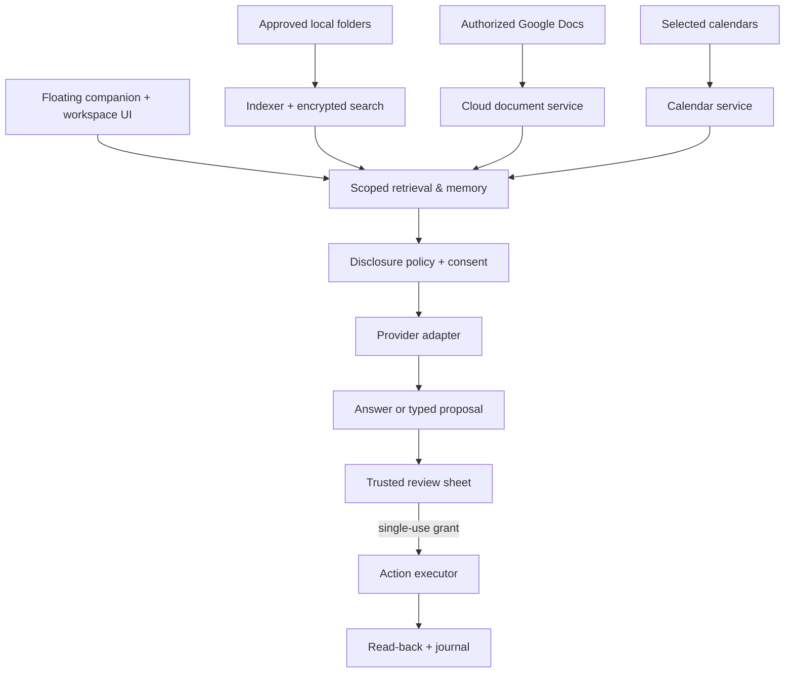

# Architecture

Companion is a single-user native macOS app. All indexing, memory and policy run locally; the Mac talks directly to the selected model provider and to approved Google APIs. There is no hosted backend for user content.

Search and opening go straight from the UI to the index and `NSWorkspace` — no model call.

## Targets

| Target | Role |
| --- | --- |
| `CompanionCore` | All domain logic. No AppKit UI. Fully unit-tested. |
| `Companion` (`CompanionApp`) | AppKit panels (floating icon, hover menu), SwiftUI workspace, onboarding, menu bar, global shortcut, login item, notifications. |
| `CompanionCoreTests` | XCTest suites with scripted HTTP/LLM/calendar doubles. |

## Components (CompanionCore)

| Component | Files | Responsibility |
| --- | --- | --- |
| Persistence | `Persistence/*` | Serialized SQLite connection (one write path), WAL, versioned migrations with pre-migration backup and refusal of newer schemas, typed settings, activity journal. |
| Security | `Security/*` | Keychain secret store; AES-GCM cipher (key in Keychain) for extracted text, cached cloud excerpts and Docs recovery payloads. |
| Indexer | `Indexing/*` | Root scanning (skips bundles, credentials, dependency/VCS dirs, managed output; never follows symlinks), stable identity via device+inode for rename detection, stabilization window, extraction queue, FSEvents hints + reconciliation scans. |
| Search | `Indexing/SearchIndex.swift` | Contentless FTS5 (tokens only) + row map; snippets produced after decrypting segments; query terms sanitized. |
| Workspace | `Workspace/*` | Projects (virtual), cards (reference / working copy / cloud doc / event), checkpoints, working-copy lifecycle (copy → verify → atomic `RENAME_EXCL` publish, divergence states), copy-only rules (disabled by default, quota, once per file). |
| Policy | `Policy/*` | `ActionPlan` (hashed operation list), state machine, `ApprovalAuthority` (single-use, 60 s, plan-hash- and policy-version-bound grants), `ActionExecutor` (deterministic validation, read-back, journal, undo, crash reconciliation), `PathGuard`. |
| Memory | `Memory/*` | Memory records with provenance/status/sensitivity/provider limits, conflict detection, tombstones; `RetrievalService` resolves disclosure for every item; `ContextPacketBuilder` splits allowed / needs-consent / excluded and re-validates before sending. |
| Providers | `Providers/*` | `LLMProvider` protocol, SSE parser, Anthropic (Messages, `anthropic-version: 2026-10-21`, server-side refusal fallback), OpenAI (Responses, `store:false`), DeepSeek (chat completions). Budget reservations, tool registry (read + proposal tools only), conversation orchestration with bounded tool loops. |
| Google | `Google/*` | PKCE/state OAuth via loopback receiver, token refresh/revocation, allowlisted API client with backoff (writes never retried), Drive/Docs calls, tab-aware Docs parser with coverage, change-cursor sync, Docs edit/create/copy performer with revision checks and reconciliation via `appProperties` markers. |
| Calendar | `Calendar/*` | EventKit abstraction, mirrored store with identity reconciliation, focus-block performer. |
| Organization | `Organization/*` | Filing analyzer → candidate rules; placement ranking with reasons, abstention and correction learning; baseline for evaluation. |
| Assistance | `Assistance/*` | Requirement extraction, tasks with proposed/confirmed deadlines, Today suggestions (≤3, explained, local only), notification policy. |
| Lifecycle | `Lifecycle/*` | Composition root, startup maintenance, export, backup, prepare-to-uninstall, app-data removal preview, single-instance lock. |

## Request path

1. **Gather** (`RetrievalService.gather`): attached sources, project memories, latest checkpoint, open tasks/requirements, linked events, then scoped FTS hits — scope is applied *before* ranking.
2. **Classify** (`ContextPacketBuilder.build`): each item's composite disclosure policy (root ∧ project ∧ document ∧ memory limits) yields allow / ask / deny for the chosen provider.
3. **Consent**: “ask” items stop the request; the user can send once, always allow for the project, send without them, or cancel.
4. **Re-validate** immediately before transmission (revoked folders, lost Google access, changed settings → refuse).
5. **Budget**: reserve the maximum estimated cost; refuse at the limit; settle with reported usage.
6. **Model call** with streaming; tool calls run only bounded read tools or record *proposals* (`ActionPlan` / proposed memory). The model can never approve.
7. **Review & execute** in the app: the review sheet issues a grant for the exact plan hash; the executor re-validates every operation, writes, reads back and journals.

## Data model

Tables (see `Persistence/Schema.swift`): `projects`, `roots`, `file_assets`, `file_versions`, `working_copies`, `copy_rules`, `project_items`, `checkpoints`, `calendar_items`, `tasks`, `requirements`, `memories`, `memory_tombstones`, `conversations`, `messages`, `action_runs`, `approval_grants`, `recovery_records`, `usage_entries`, `budget_reservations`, `connector_accounts`, `cloud_assets`, `document_segments`, `organization_rules`, `placement_feedback`, `sync_cursors`, `activity`, `notifications_log`, `search_docs`, `search_index` (FTS5, contentless).

Internal UUIDs are independent of paths. Credentials are never stored in the database (only Keychain account references).

## Process model and sandbox

The app runs sandboxed (`App/Companion.entitlements`): user-selected read-write files with app-scoped security bookmarks, network client (providers, Google), network server (127.0.0.1 OAuth redirect only), calendars. Extraction runs in-process with size/page/character limits and no network or write capability; moving extraction and the executor into separate XPC services is a documented next step (see REQUIREMENTS.md).
